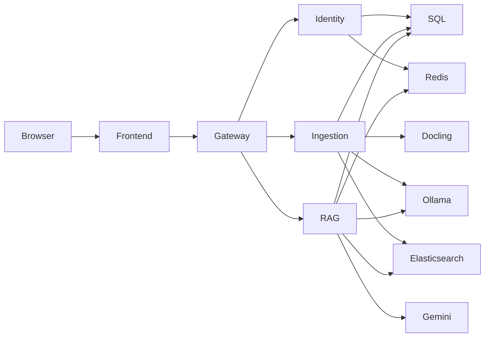

# LedgerLens

Financial-PDF analysis workspace with persistent documents, private conversations, and document/page/chunk citations. React/TypeScript calls a FastAPI gateway backed by identity, ingestion, and retrieval modules. Docling is the only PDF parser.

Low-temperature generation and valid citation identifiers do not establish financial correctness. Verify material conclusions against the original PDF.

## Architecture



| Module | Container port | Responsibility |
| --- | ---: | --- |
| Gateway | 8000 | Verify credentials, strip identity overrides, stream proxy requests |
| Identity | 8001 | Accounts, signed tokens, durable token revocation, ownership transfer |
| Ingestion | 8002 | Persistent PDF storage, bounded Docling workers, embeddings, indexing, cleanup |
| RAG | 8003 | Authorized selected-source retrieval, private history, generation, citation validation |
| Frontend | 80 | Same-origin API/PDF access and SPA route fallback |

PostgreSQL 16 stores accounts, permissions, conversations, work claims, and leases. Redis 7 stores token revocation identifiers; it is not the job queue. Elasticsearch 8.12 stores versioned evidence chunks. Ollama provides embeddings; Gemini provides generated answers.

## Access and retention

- Every upload is persistent until explicitly deleted. Logout, clearing messages, and deleting a conversation do not delete documents or sharing grants.
- An active document is readable/queryable by an administrator, its current owner, or an explicit access recipient; otherwise access is denied. Deleting/cleanup-pending documents are unavailable regardless of grants.
- `owner_id` is current ownership. `uploaded_by_id` is original attribution and does not confer continuing ownership after transfer.
- Only administrators change sharing or wipe the store. Owners and administrators may delete individual documents; recipients cannot delete the shared original.
- Conversations are owner-only, including against administrators. Foreign conversation/document lookups use 404 rather than disclosing existence.
- Account deletion requires `transfer_to=<active-admin-id>` when documents need an owner. It preserves attribution and recipient grants, transfers current ownership, and deletes the departing account's private conversations rather than transferring them.
- Already delivered content, downloaded PDFs, and content sent to an external model cannot be recalled.

### Conversation sources and saved answers

Starting a conversation opens a document picker: choose one or more accessible, searchable documents, and the conversation is created with exactly that set. There is no operation that changes it afterwards; a new conversation is required to use different documents. Creating a conversation without documents is rejected. Selecting all accessible documents captures their identifiers, not a subscription to later uploads or grants.

PDFs are uploaded only from the Documents page, never from inside a conversation. Reloading, regenerating, and clearing messages keep the conversation's documents. If any of them becomes inaccessible or unavailable, document questions are blocked rather than silently querying a subset. The first document question also names an untitled conversation.

SQL permissions determine the exact document/version filters on both vector and keyword search. Index ACL copies are not an authority. Access is checked before sending evidence to generation and again before releasing the answer.

Each assistant turn records all supporting documents in the supplied context, including retained assistant history, not just cited pages. Losing any supporting source hides the whole affected answer and its citations, and excludes that original answer from subsequent model context. Unaffected answers remain readable. Browser history is loaded from the server; browser storage is not a durable conversation store.

### Authentication

Protected routes require an unexpired signed Bearer token with `sub`, `id`, `exp`, and `jti`, matched to the current database account and supported role. Client headers, forms, query parameters, token role claims, and JSON identity fields cannot override that account.

Successful logout revokes that token across processes for its remaining lifetime. Other valid tokens are unaffected. Revocation-store failure returns 503 and protected requests fail closed; the browser does not falsely report successful logout or treat an outage as credential expiry.

Passwords are bcrypt-hashed, not encrypted. Account passwords are bounded to 72 UTF-8 bytes. Initial administrator configuration additionally rejects missing/known unsafe credentials; an existing account's password is never silently reset at startup.

## Ingestion and failures

- `POST /api/documents` accepts exactly one multipart `file`, without scope/session/identity/sharing fields. PDFs over `UPLOAD_MAX_PAGES` (default 40) or `UPLOAD_MAX_BYTES` (default 20 MB) are rejected before anything is queued.
- File limit: **50 MiB**. Gateway and ingestion bound raw multipart input with a fixed 1 MiB overhead allowance before parsing. File copying uses 64 KiB reads.
- Original filenames are bounded metadata; unsafe paths/control characters are rejected. Stored names are generated. PDF signature and readability are validated.
- Documents progress through `queued`, `processing`, `searchable`, or `failed`; deletion may be `deleting`/`cleanup_pending`. Jobs expose `queued`, `processing`, `completed`, `failed`, or `cleanup_pending`, with stage/error information.
- Completion requires usable extraction and every intended chunk indexed and visible. Empty extraction, incompatible vectors, partial indexing, and provider failures are not success.
- SQL work claims survive process loss. Leases and fencing tokens prevent stale workers publishing; recovery advances the document version so old in-flight writes cannot become current evidence. Repeated worker losses eventually require explicit reindexing rather than endless apparent progress.
- Deletion first removes authoritative access, then reconciles PDF/index/metadata cleanup. A 503 cleanup-pending response means access is removed but physical cleanup is unfinished. Reconciliation retries without resurrecting the document. Store wipe targets the captured document set, not arbitrary files in the upload directory.

### Docling only

There is no AnyDoc integration, alternate PDF parser, or hosted OCR fallback. Missing/failed Docling and unsupported/empty output fail explicitly.

Docling conversion runs in a killable, spawn-isolated child process, bounded by `PARSER_TIMEOUT_SECONDS` (default 180). Uploads over `UPLOAD_MAX_PAGES` (default 40) or `UPLOAD_MAX_BYTES` (default 20 MB) are refused before anything is queued, one ingestion worker runs by default, and Compose caps the ingestion container at `INGESTION_CPUS` (2) and `INGESTION_MEMORY` (4g). Spawn avoids inheriting native-library locks from API-worker threads. `DOCLING_DEVICE=cpu` is the conservative default. Native accelerated runtimes may explicitly choose `mps`, `cuda`, or `auto`, but changing this setting cannot add GPU support to the supplied CPU-only Linux image.

Chunks use actual token measurement, preserve table headers and section context, and split supported tables at row boundaries. Oversized indivisible rows/headers or unsupported oversized table layouts fail instead of being flattened and advertised as preserved financial tables. Markdown does **not** losslessly preserve every merged-cell layout. Page counts come from the document structure, not the largest page containing extracted text.

The Linux image includes Fontconfig and Liberation fonts. These are extraction dependencies: without usable substitute fonts, Docling's native rasterizer can draw character boxes and miss otherwise readable financial tables.

First use downloads public model weights. Provision their cache/network access and processing budget for your documents. The upload size ceiling does not guarantee every document finishes within the configured parser deadline.

### Real model dependencies

Ollama's `embeddinggemma` model supplies 768-dimensional vectors by default. Incompatible model/dimension metadata is rejected. There is no hash-vector substitute.

Gemini defaults to `gemini-3.5-flash-lite` with explicit low temperature. Citation tags (`[Citation: <chunk_id>]`) must identify supplied evidence; structured citations include document, page, chunk, and an authenticated source URL. Missing/invalid references result in abstention rather than manufactured citations. Provider failures return 503, not canned financial analysis.

`RAG_GENERATOR_ADAPTER=deterministic` is restricted to `ENV=test`. It is test infrastructure for behavioral checks, not financial analysis or an accuracy benchmark.

## Install and configure

Supported lock targets: Python **3.13**, Node.js **24**, macOS ARM64 and Linux ARM64/AMD64. Current macOS PyTorch wheels require macOS 14 or later. Linux ingestion locks select official CPU-only PyTorch/Torchvision wheels; they do not install the CUDA stack.

Native Debian/Ubuntu ingestion also needs the system libraries supplied by its image: `sudo apt-get install libgomp1 libgl1 libglib2.0-0 fontconfig fonts-liberation`. Readiness rejects missing usable Linux fonts, and parsing fails explicitly instead of indexing character-box rasters.

Create an isolated environment before running local modules or checks:

```bash
python3.13 -m venv .venv
source .venv/bin/activate
python -m pip install --require-hashes -r requirements-dev.lock
npm --prefix frontend ci
export PYTHONPATH="$PWD/packages/common/src:$PWD"
```

`requirements.lock` contains the lightweight shared runtime; ingestion and RAG each have their own complete runtime lock. `requirements-dev.lock` includes both and the verification tools. Node installs use `frontend/package-lock.json` and `npm ci`, without an unlocked install fallback.

Copy `.env.example` to `.env` only if you do not already have a configuration. Supply private values; never commit or paste credentials into reports:

- `JWT_SECRET`: at least 32 private random bytes; generate with `openssl rand -hex 32`.
- `ADMIN_INITIAL_PASSWORD`: explicitly supplied for first bootstrap, at least 12 characters and at most 72 UTF-8 bytes.
- `POSTGRES_PASSWORD`: required by Compose. A generated hex password avoids reserved characters in the composed database URL; otherwise URL-encode database credentials correctly.
- `GEMINI_API_KEY`: valid key required for generated financial answers. Set it through the environment/secret manager, not a command-line argument.
- `OLLAMA_HOST`, `EMBEDDING_MODEL`, `EMBEDDING_DIMS`, `ES_INDEX`, storage locations, origins, and time budgets: see `.env.example` and `common.config.Settings`.

Start Ollama and provision the embedding model:

```bash
ollama pull embeddinggemma
```

Do not use `ENV=test` for a shared or untrusted deployment. Rotate external credentials in their provider; editing application code does not rotate a key. Changing the JWT signing secret invalidates existing tokens across all modules.

### Local launcher

```bash
./run.sh
```

The launcher resolves its own repository directory, uses one selected Python interpreter (`PYTHON_BIN` can override it), starts development datastores, and runs schema **checks** before modules. Occupied application ports abort startup without killing their occupants. Shutdown targets launcher-owned processes only.

### Containers

```bash
# For Docker Desktop, not localhost inside a container:
# OLLAMA_HOST=http://host.docker.internal:11434

docker compose up -d --build
docker compose ps
curl -f http://127.0.0.1:8000/health
curl -f http://127.0.0.1:8000/ready
```

Default edge bindings are loopback: frontend `127.0.0.1:3000`, gateway `127.0.0.1:8000`. Datastores/downstream modules publish no host ports. For host development access, explicitly use:

```bash
docker compose -f docker-compose.yml -f docker-compose.dev.yml up -d
```

Uploads persist in the named `uploads_data` volume. When the schema changes, reset it together with the database and the Elasticsearch index; there is no in-place upgrade. Nginx provides SPA fallback and same-origin `/api/`, `/health`, and `/ready` proxying, including streaming uploads. Public deployment additionally requires an appropriately configured TLS edge and host/network controls; loopback bindings alone are not a universal security guarantee.

`localhost` inside an ingestion/RAG container is that container, not the host Ollama process. On Linux, use a reachable provider on the container network or configure the host gateway explicitly; do not assume a particular bridge IP exists on every machine.

Liveness is separate from readiness. `/health` can remain 200 while required SQL, revocation, search, embedding-model, parser, or generation dependencies make `/ready` return 503. Generation readiness uses a non-generation model-metadata probe, not a paid generation request.

## Schema and resets

Startup runs `python -m common.migrate check`: an empty database gets the current schema (`20261108_clean_schema`), a current one is accepted, and anything else is refused with an instruction to wipe it. There is deliberately no upgrade path from older schemas; reset the database, the Elasticsearch index, and the uploads volume together.

The schema enforces its own invariants: foreign keys on every enforceable relationship, `document_access` and `chat_session_documents` link tables instead of JSON id lists, `CHECK` constraints on roles, statuses and job stages, and `timestamptz` columns that the application always reads as UTC. A chat's documents are fixed at creation; `chat_session_documents.document_id` intentionally has no foreign key, so deleting a document can't silently shrink a chat's evidence set.

To parse a document again (for example after a failure), use `POST /api/documents/{id}/reindex`, or `python -m common.migrate reindex --document-id DOC_ID` as an operator.

## HTTP contracts

All business routes except login require Bearer credentials, at the gateway and directly downstream. Unknown JSON identity fields are rejected. Resource identifiers and practical request limits are validated.

| Area | Operations |
| --- | --- |
| Authentication | `POST /api/auth/login`, `GET /api/auth/me`, `POST /api/auth/logout` |
| Accounts (admin) | `GET/POST /api/users`, `DELETE /api/users/{id}?transfer_to=ADMIN_ID` (204) |
| Documents | `POST /api/documents` (one multipart `file`, 202), `GET /api/documents`, `GET /api/documents/{id}/source`, `PUT /api/documents/{id}/access`, `POST /api/documents/{id}/reindex`, `DELETE /api/documents/{id}` (204) |
| Jobs | `GET /api/jobs/{id}` |
| Store wipe (admin) | `DELETE /api/documents` |
| Conversations | `GET /api/chat/sessions` (summaries), `POST /api/chat/sessions` with one or more `selected_document_ids` (201), `GET /api/chat/sessions/{id}`, `DELETE /api/chat/sessions/{id}` (204) |
| Questions | `POST /api/chat/sessions/{id}/messages` with `message`; `DELETE /api/chat/sessions/{id}/messages` clears history (204) |
| Regeneration | `POST /api/chat/sessions/{id}/regenerate` with the latest assistant `message_id` |
| Paging | List endpoints take `?limit=` (1–200, default 50) and `?offset=` and return `{items, total, limit, offset}` |

## Verification

```bash
# Isolated SQL/uploads/cache/credentials, no paid generation:
bash scripts/run_checks.sh

# Explicit behavioral evaluation with real Docling/Ollama/Elasticsearch:
python scripts/evaluate.py --deterministic --output /tmp/ledgerlens-behavior.json

# Explicit live generation; supply GEMINI_API_KEY through the process environment:
python scripts/evaluate.py --live --output /tmp/ledgerlens-live.json
```

Evaluation uses synthetic reports, known conflicting values, selected-source restrictions, source/page checks, abstention, and unauthorized-access cases. It creates owned resources and a unique index, and records observed results/configuration. Deterministic generation checks are not model-quality results. External-provider failures must remain failed/unexercised prerequisites, not passing accuracy claims.

Dependency audits:

```bash
npm --prefix frontend audit
python -m pip_audit -r requirements.lock --no-deps --disable-pip
```

### Evidence from the hardening work

Historical observations, not guarantees for a new environment; rerun the entry points above and use their actual output.

- **Isolated checks:** the backend suite passes **91 tests** in a virtual environment installed from `requirements-dev.lock` (Python 3.13, macOS arm64), including live multi-service HTTP tests and schema-invariant tests. The frontend passes lint, TypeScript, and production build.
- **Dependencies:** the Python lock audit and frontend audit reported no known vulnerabilities for the resolved versions when checked. That says nothing about future advisories or OS/image packages.
- **Schema on PostgreSQL 16:** a wiped database bootstrapped `20261108_clean_schema` with `timestamptz` columns, every foreign key, and the role/status/stage `CHECK` constraints.
- **Containers:** all application images built and an isolated PostgreSQL-backed Compose stack served login, with only the frontend and gateway ports published on loopback. Linux runs exposed two defects that macOS checks hid: a forked worker stalled Docling, and missing fonts made Docling lose a financial table. Both are fixed (spawned parser process; Fontconfig/Liberation fonts plus a font readiness check). The latest code was verified in running containers but has not yet been rebuilt into fresh images.
- **Real Docling → Ollama `embeddinggemma` → Elasticsearch 8.12:** Apple's 4-page Q4 FY2024 statements produced 14 chunks (8 tables, at most 512 tokens each) in 79 s under the 2-CPU cap; table headers and period columns stay with every row group. A 150-page annual report was refused at upload by the 40-page limit. A worker restart recovered accepted work under a newer version without duplicating evidence or keeping obsolete-version chunks.
- **Live Gemini (`gemini-3.5-flash-lite`):** on Apple's filing, quarter and full-year net sales, iPhone and Services revenue, the tax-charge explanation, and GAAP/non-GAAP EPS were answered correctly with page citations, and a guidance question was correctly declined. A synthetic Contoso report scored 6/6 after fixing a parser bug that rejected grouped citation tags.
- **Deletion:** during a real Elasticsearch outage, deletion returned 503, denied source access, and masked saved answers. Metadata, chunks, and the PDF were removed after recovery, and unrelated and unmanaged PDFs survived. Regression tests use a real read-only upload directory to show that a disk failure stays pending and denied until storage recovers, and that a store wipe during an active worker claim cannot be republished by that worker.
- **Browser:** the redesigned UI (document picker, fixed chat documents, numbered citations, paged lists) was exercised manually. The scripted browser checks predate the redesign and need re-running.
- **Evaluation:** the last strict deterministic run scored **3/6** with the test-only generator; it measures the harness, not live answer quality, and has not been re-run with Gemini.
- **Not verified:** production load, latency at scale, multi-instance deployment, backups, and universal financial accuracy. No such claims are made.

No verification is performed against the owner's existing database/uploads by default, and no external credential rotation is implied.
